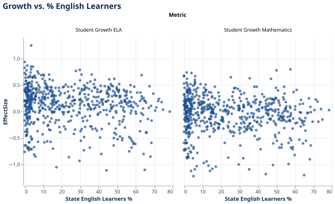
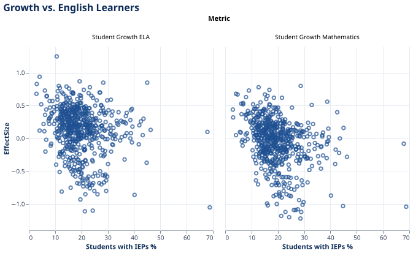
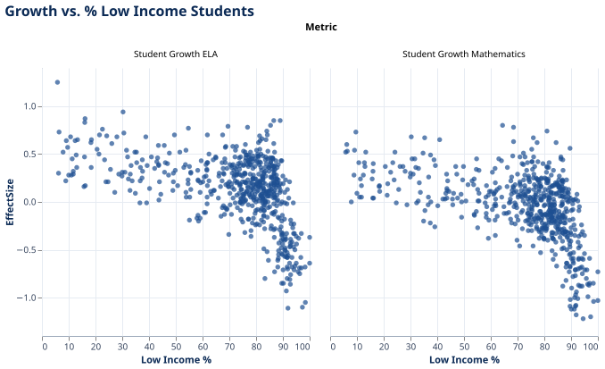
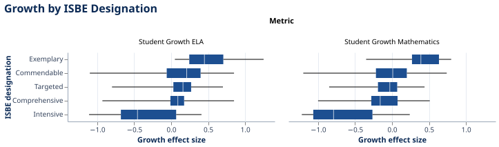
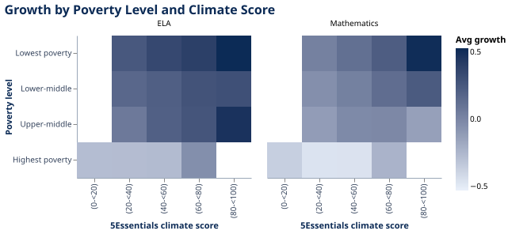
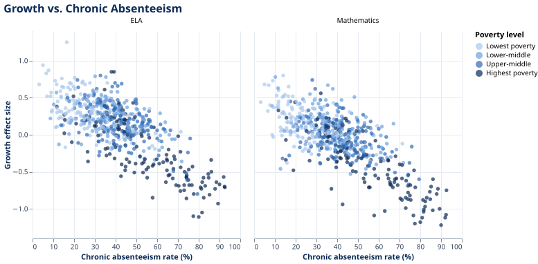
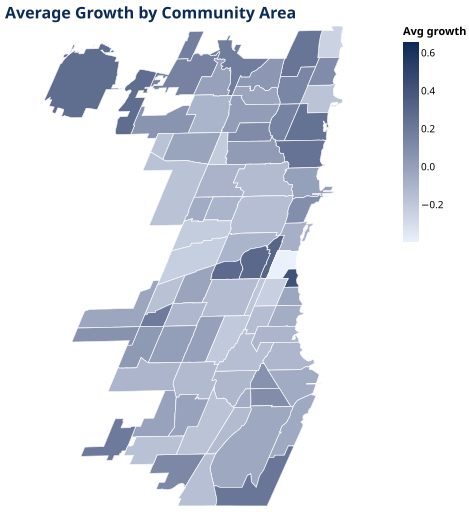
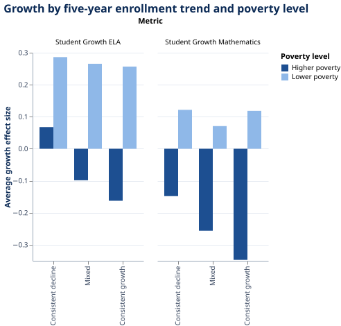

# Beyond Poverty: What Else Relates to Academic Growth in Chicago Public Schools?

Kaed Esposo

## What is your current goal? Has it changed since the proposal?

My goal is to explore how academic growth in Chicago Public Schools (CPS) relates to school characteristics, and in particular whether anything beyond poverty is associated with growth. Growth is measured with the Academic Progress Indicator effect size, which compares a school's student growth to typical statewide growth for students with similar starting achievement. My first charts show that poverty and growth are strongly linked, so the draft is organized around a follow-up question: among schools with similar poverty levels, what else moves with growth? I look at school climate (5Essentials), chronic absenteeism, and enrollment trends, and then at how growth is distributed across Chicago's community areas.

## Are there data challenges you are facing? Are you currently depending on mock data?

I am not using mock data. Every chart uses real data from CPS, ISBE, 5Essentials, and the Chicago Data Portal, and all of the data acquisition and cleaning is done.

The challenges so far have been minor. The growth data is in long format (one row per school per subject), so I show ELA and math as separate panels. Joining the sources required standardizing School ID types and dropping rows without an ID. The 5Essentials data needed to be reshaped to one row per school, and I averaged the five measures into a composite climate score. For the enrollment chart, I kept only schools with data in all five years and defined "consistent decline" and "consistent growth" as at least three of four yearly changes in the same direction, which is a judgment call I would like feedback on.

## Describe each of the provided images with 2-3 sentences to give the context and how it relates to your goal.

All charts use a custom blue theme (navy marks, light blue gridlines), chosen to echo the blue used by CPS.

**1. Growth vs. Low-Income Students (scatter, ELA and math).**

Each dot is a school. Growth stays fairly flat until roughly 60-70% low-income and then drops sharply for the highest-poverty schools in both subjects. This opens the narrative by showing how strongly poverty and growth are linked, which raises the question of what else matters.

**2. Growth vs. English Learners (scatter, ELA and math).**

This shows the same comparison using the share of English learners. There is no strong pattern, and schools at every level of English learner enrollment span a wide range of growth. I am keeping it as a contrast to the poverty chart, since not every demographic measure is tied to growth in the same way.

**3. Growth vs. Students with IEPs (scatter, ELA and math).**

This repeats the comparison using the share of students with IEPs, with most schools clustered between about 10% and 30%. The relationship looks weak, with a slight downward tilt in math. It is a candidate to cut if the narrative needs to be shorter.

**4. Growth by ISBE Designation (box plot, ELA and math).**

Each box shows the spread of growth for schools in one state accountability category. Exemplary schools show the highest growth and Intensive schools the lowest, with a lot of overlap among the middle categories. This checks whether the state's ratings line up with the growth measure, and I plan to reorder the categories from highest to lowest rating.

**5. Growth by Poverty Level and Climate Score (heatmap, ELA and math).**

Each square is the average growth of schools in one poverty group and one climate score range, so reading across a row compares schools with similar poverty. In the lower-poverty rows, growth rises as climate scores increase, though some corners are empty because poverty and climate are correlated. This is the main chart for asking whether climate relates to growth beyond poverty. I still need to add school counts to each square so readers can tell which squares rest on few schools.

**6. Growth vs. Chronic Absenteeism (scatter, ELA and math).**

Schools with higher chronic absenteeism have lower growth in both subjects, and dots are shaded by poverty level, with darker blue meaning higher poverty. The downward pattern appears within the highest-poverty group as well as the others, but the highest-poverty schools dominate the far right of the chart, so absenteeism and poverty cannot be fully separated there. This extends the poverty question to attendance, and I plan to try one panel per poverty group.

**7. Average Growth by Community Area (choropleth map).**

Each of Chicago's 77 community areas is shaded by the average growth of the schools in it, averaging ELA and math. This shows where growth is concentrated geographically and lets me check whether the geography reflects the poverty pattern from chart 1. Areas with no schools appear gray, and I am deciding whether to also gray out areas with only a few schools. [Add one sentence on what the map shows.]

**8. Growth by Enrollment Trend and Poverty Level (grouped bar, ELA and math).**

Schools are grouped by their five-year enrollment trend (consistent decline, mixed, consistent growth), with separate bars for lower- and higher-poverty schools split at the median. Requiring a consistent trend avoids treating a one-year fluctuation as real decline, and splitting by poverty checks whether any pattern is more than a poverty effect. This connects the story to CPS's declining enrollment and enrollment-based staffing. [Add one sentence on what the bars show, and note any bars based on few schools.]

## What form do you envision your final narrative taking?

I envision an article that walks through the charts in order. It would begin with the poverty and growth relationship, then test other explanations (climate, attendance, enrollment), then show the geography, and end with what the evidence does and doesn't suggest. The graphs would be embedded with short captions.
